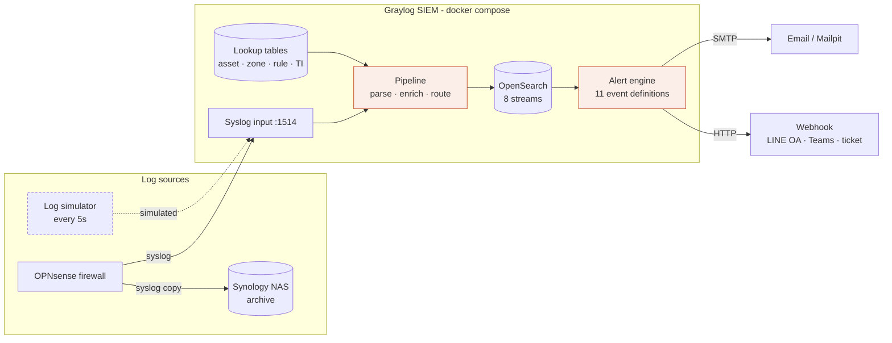

# SIEM POC: OPNsense → Graylog

POC สำหรับเตรียมตรวจ ISO/IEC 27001:2022 โดยรวม log ของ OPNsense ไว้ที่ Graylog แยก field, เติมบริบทว่า **ใคร / จากไหน / ไปไหน**, และยิง alert ไปยัง Email/Webhook

- Requirement (ภาษาไทย, ใช้คุยร่วมกัน): [docs/REQUIREMENTS.md](docs/REQUIREMENTS.md)
- Diagram (architecture, log journey, alert perspectives, integration points): [docs/architecture.html](docs/architecture.html) เปิดใน browser



> OPNsense เป็น FreeBSD จึงรันใน Docker ไม่ได้ POC นี้ใช้ **simulator** ส่ง log รูปแบบเดียวกับ OPNsense จริง (RFC5424: filterlog, suricata, audit, openvpn, dhcpd, unbound) ทำให้ pipeline เดียวกันใช้กับเครื่องจริงได้ทันที

## เริ่มใช้งาน

ต้องมี Docker (RAM ว่าง ≥ 4 GB)

```bash
docker compose up -d
```

ครั้งแรกใช้เวลาประมาณ 1–2 นาที `provisioner` จะสร้าง input, lookup table, stream, pipeline และ alert ให้อัตโนมัติ จากนั้น `generator` จะเริ่มยิง log

| URL | ใช้ทำอะไร |
|---|---|
| http://localhost:9000 | Graylog (user `admin` / pass `admin`) |
| http://localhost:8025 | Mailpit: อีเมล alert |
| http://localhost:8088 | Webhook receiver: alert ที่จะส่งไป LINE/Teams/ticketing (refresh ทุก 5 วินาที) |

ดูว่า provisioner ทำอะไรไปบ้าง:

```bash
docker compose logs provisioner
```

## ทดลองใช้

**ดู log ที่ parse แล้ว:** Graylog › Search แล้วลอง query

```text
event_category:firewall AND fw_action:block
src_zone:Guest AND dst_zone:Server
threat_indicator:true
event_type:gui_login_failure
```

**ดู alert:** Graylog › Alerts (หรือดูที่ Mailpit/Webhook) alert ถูกประเมินทุก 1 นาที ส่วน IAM-03 (admin login นอกเวลา) จะยิงเฉพาะช่วง 19:00–07:59 เวลาไทย

**ยิงทุก scenario ทันที** (ใช้ตอน demo):

```bash
docker compose run --rm --no-deps generator python /app/opnsense_simulator.py --play all
```

หรือเลือกเฉพาะบางตัว เช่น `--play port_scan c2_beacon` (มี `port_scan`, `gui_bruteforce`, `admin_login_unusual`, `config_change`, `c2_beacon`, `phishing_dns`, `vpn_bruteforce`, `guest_lateral`, `ids_web_attack`, `vpn_login_ok`)

**ทดสอบ alert "log หาย" (OPS-01):**

```bash
docker compose stop generator
```

รอประมาณ 5–6 นาทีจะมี alert แล้วค่อย `docker compose start generator` (หมายเหตุ: ตอนเริ่ม stack ครั้งแรกจะเห็น OPS-01 หนึ่งครั้ง เพราะยังไม่มี log เข้ามา)

**ปรับความถี่:** `INTERVAL_SECONDS=2 SCENARIO_RATE=0.5 docker compose up -d generator`

## ต่อกับ OPNsense จริง

1. OPNsense › System › Settings › Logging › Remote › Add
   - Transport: UDP(4) หรือ TCP(4) · Hostname: IP ของเครื่องที่รัน POC · Port: `1514`
   - Applications: เลือก filter (filterlog), suricata, audit, openvpn, dhcpd, unbound (หรือเว้นว่างไว้ = ทั้งหมด)
   - **ติ๊ก RFC5424**
2. Firewall rule ที่ต้องการให้เห็น traffic ต้องเปิด "Log packets that are handled by this rule"
3. Intrusion Detection › Administration › เปิด **Enable syslog alerts**
4. Unbound DNS › Advanced › เปิด **Log Queries** (ถ้าต้องการ DNS)
5. แก้ไฟล์ใน `graylog/lookup/` ให้ตรงกับบริษัท (asset จริง, subnet จริง, rule ID จริงซึ่งดูได้จาก Firewall › Log Files › Live View)
6. เทียบ log จริงกับ regex ใน `graylog/pipeline/*.rule` ถ้ารูปแบบต่างจากที่ simulator ส่ง (เช่นใช้ dnsmasq แทน ISC dhcpd) ให้แก้ rule แล้วรัน provisioner ใหม่

## โครงสร้าง repo

```text
docker-compose.yml            # mongodb, opensearch, graylog, provisioner, generator, mailpit, webhook
generator/opnsense_simulator.py  # ยิง log แบบ OPNsense ทุก 5 วินาที + attack scenarios
graylog/pipeline/*.rule       # parse (stage 0) → enrich (stage 1) → route (stage 2)
graylog/pipeline/opnsense.pipeline
graylog/lookup/*.csv          # asset inventory, network zones, firewall rules, threat intel
provisioner/provision.py      # สร้างทุกอย่างผ่าน Graylog REST API (รันซ้ำได้)
webhook/receiver.py           # รับ HTTP notification แทน LINE/Teams/ticketing
docs/                         # requirement + diagram
```

แก้ rule หรือ alert แล้ว apply ใหม่ (provisioner จะ update rule, pipeline และ alert ที่มีอยู่แล้ว):

```bash
docker compose run --rm provisioner
```

แก้ CSV ใน `graylog/lookup/` ไม่ต้องรันอะไร Graylog อ่านไฟล์ใหม่เองทุก 60 วินาที

## Alert ที่มีใน POC

| ID | Alert | Severity |
|---|---|---|
| NET-01 | Port scan (≥15 distinct ports / 1 นาที / source) | High |
| NET-02 | Guest network พยายามเข้า Server/LAN/Management | High |
| IAM-01 | Brute force หน้า GUI firewall | High |
| IAM-02 | Admin login จากนอก Management zone | Medium |
| IAM-03 | Admin login นอกเวลาทำงาน | Medium |
| IAM-04 | VPN brute force | High |
| CHG-01 | Firewall config ถูกแก้ไข | Low |
| THR-01 | IDS alert priority 1 | High |
| THR-02 | Firewall ปล่อยผ่าน traffic ไป/มาจาก IOC | High |
| THR-03 | DNS query ไป domain อันตราย | High |
| OPS-01 | OPNsense หยุดส่ง log 5 นาที | High |

High ส่งทั้ง Email และ Webhook ส่วน Medium/Low ส่ง Email อย่างเดียว รายละเอียดและ ISO mapping อยู่ใน [docs/REQUIREMENTS.md](docs/REQUIREMENTS.md#6-alert-use-cases-ทำงานใน-poc-แล้ว)

## ข้อจำกัดของ POC (ห้ามใช้เป็น production ตามนี้)

- รหัสผ่าน `admin/admin` และ `GRAYLOG_PASSWORD_SECRET` เป็นค่าตั้งต้น ถ้าจะใช้จริงให้ตั้งใน `.env` (ดู `.env.example`)
- OpenSearch ปิด security plugin, syslog ไม่เข้ารหัส และ UI เป็น HTTP
- ใช้ index set ตั้งต้นของ Graylog ยังไม่ได้ตั้ง retention ตาม NFR-01
- filterlog parse เฉพาะ IPv4
- Identity (IP → ผู้ใช้) มาจาก CSV แบบ static เท่านั้น

## ปิด / ล้างข้อมูล

```bash
docker compose down
```

ล้างข้อมูลทั้งหมดเพื่อเริ่มใหม่:

```bash
docker compose down -v
```
