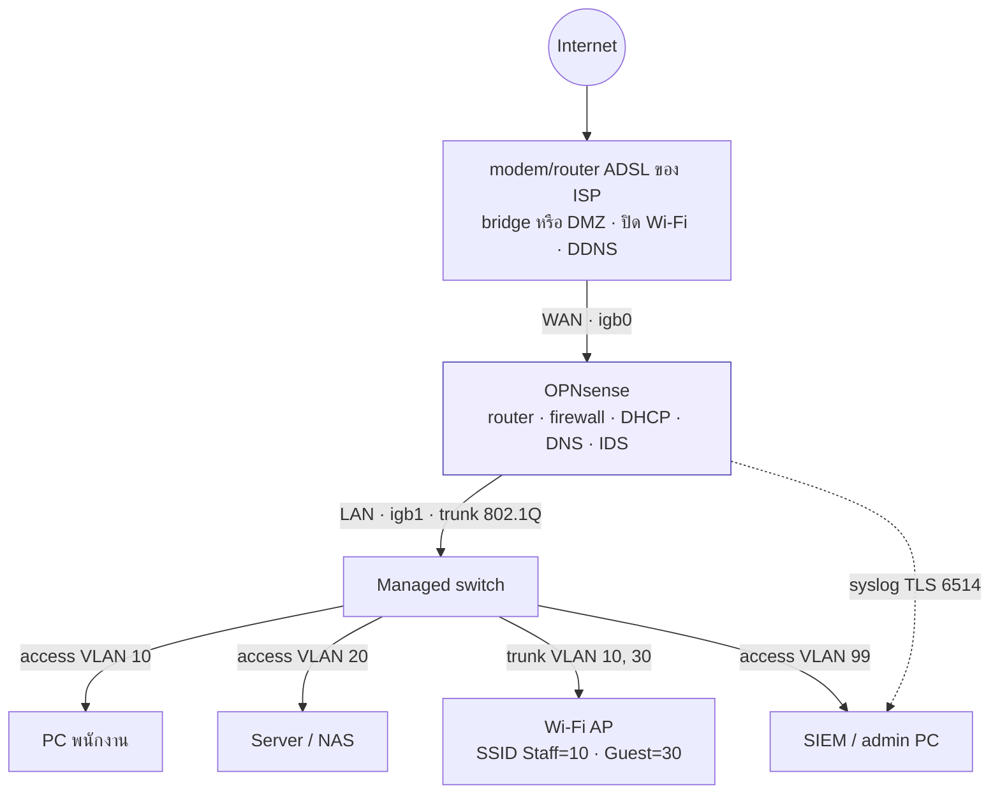
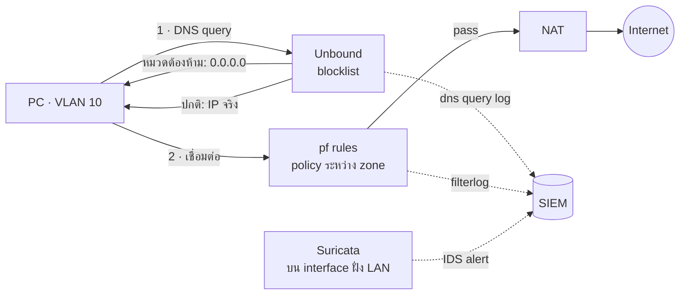
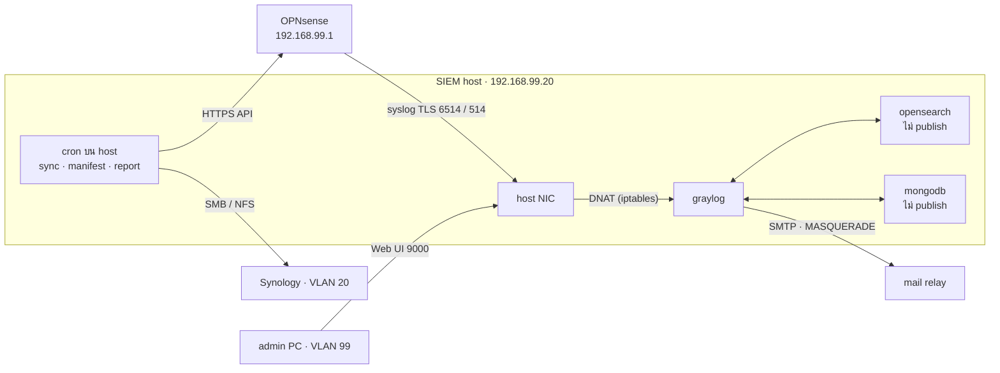

# Network Architecture: ติดตั้ง OPNsense ในเครือข่ายสำนักงาน

| | |
|---|---|
| ประเภทเอกสาร | เอกสารส่งมอบ (Architecture & Implementation Guide) |
| สถานะ | Draft v0.2 · 2026-10-23 (ISP เป็น ADSL ไม่มี fixed IP, NIC น่าจะเป็น Intel, switch/AP ยังไม่ทราบรุ่น) |
| เกี่ยวข้อง | [REQUIREMENTS.md](REQUIREMENTS.md) (Q1–Q16), [architecture.html](architecture.html) (SIEM integration), [README](../README.md) (POC และการต่อ log) |
| ใช้เมื่อ | Phase 1 เป็นต้นไป (POC ใช้ข้อมูลจำลองเท่านั้น ดู REQUIREMENTS หัวข้อ 3) |

OPNsense ต้องเป็น**ทางผ่านเดียว (single choke point)** ของ traffic ทุกอย่างระหว่างเครือข่ายสำนักงานกับ internet และระหว่าง zone ภายใน ถ้ามีทางอ้อม เช่น Wi-Fi ของ router ISP หรือเครื่องที่เสียบตรงกับ ONT traffic นั้นจะไม่ถูกกรองและไม่มี log ทำให้ตอบไม่ได้ว่าใครทำอะไร จากไหน ไปไหน ซึ่งเป็นโจทย์หลักของโปรเจกต์นี้

---

## 1. หลักการออกแบบ

| # | หลักการ | ผลต่อการออกแบบ |
|---|---|---|
| P1 | ทางผ่านเดียว | router ISP ทำหน้าที่ต่อ internet อย่างเดียว ปิด Wi-Fi และไม่มีเครื่องอื่นต่อตรง |
| P2 | แยก zone ตามระดับความไว้ใจ | Office, Server, Guest, Management และ VPN แยกกันด้วย VLAN และ firewall rule (Q1, A.8.22) |
| P3 | Default deny ระหว่าง zone | เปิดเฉพาะ traffic ที่มีเหตุผลทางธุรกิจ ที่เหลือบล็อกและ log |
| P4 | ระบุตัวตนได้ | เครื่องบริษัทได้ IP คงที่จาก DHCP static mapping (Q5) เพื่อให้ IP ใน log ผูกกับเจ้าของได้ |
| P5 | สังเกตได้ (observability) | ทุก rule ที่ข้าม zone และทุก block ต้อง log และส่งเข้า SIEM ผ่าน TLS (NFR-05) |
| P6 | ดูแลได้ด้วย IT 1–2 คน | ใช้ของมาตรฐาน (VLAN, DHCP, DNS blocklist) ไม่มีส่วนที่ต้อง tune ตลอดเวลา |
| P7 | กู้คืนได้เร็ว | backup config ทุกวัน (Q12), ไฟดับแล้วเครื่องกลับมาเปิดเอง, มีแผนถอยกลับระหว่างเปลี่ยนระบบ |

## 2. สภาพปัจจุบันเทียบกับเป้าหมาย

| หน้าที่ | ปัจจุบัน (router บ้าน) | เป้าหมาย |
|---|---|---|
| ต่อ internet | router ISP | modem/router ADSL ของ ISP (bridge หรือ DMZ) + DDNS |
| Router, NAT, firewall | router ISP | OPNsense |
| แจก IP (DHCP) | router ISP | OPNsense แยกตาม VLAN + static mapping |
| DNS | DNS ของ ISP | Unbound บน OPNsense + blocklist (FR-16) |
| Wi-Fi | router ISP (วงเดียว ทุกคนอยู่ด้วยกัน) | Access Point, SSID Staff/Guest แยก VLAN |
| พอร์ต LAN | ด้านหลัง router | Managed switch (802.1Q) |
| IDS/IPS | ไม่มี | Suricata บน OPNsense (Q8) |
| Log | ดูบนเครื่อง / Synology | SIEM (Graylog) + archive บน Synology (Q2, Q10) |

## 3. Logical topology

ทุก zone มี gateway อยู่บน OPNsense (sub-interface ของ VLAN บน igb1) ดังนั้น traffic ระหว่าง zone ต้องผ่าน firewall rule เสมอ switch ทำหน้าที่แค่แยก VLAN ไม่ route ระหว่าง VLAN เอง

> ถ้าซื้อ switch แบบ Layer 3 อย่าเปิด inter-VLAN routing บน switch เพราะ traffic ระหว่าง zone จะไม่ผ่าน OPNsense (ผิดหลัก P1)

## 4. แผน zone และ IP

ใช้ subnet เดียวกับ POC เพื่อให้ lookup และ alert ใช้ได้ทันที (`graylog/lookup/network_zones.csv`)

| VLAN | Zone | Subnet | Gateway | DHCP | อยู่ใน zone นี้ |
|---|---|---|---|---|---|
| 10 | LAN-Office | 192.168.10.0/24 | 192.168.10.1 | .100–.199 สำหรับเครื่องที่ไม่ได้ map, static mapping สำหรับเครื่องบริษัท | PC, notebook, printer ของพนักงาน, Wi-Fi Staff |
| 20 | Server | 192.168.20.0/24 | 192.168.20.1 | ไม่เปิด (IP fix ทุกเครื่อง) | Server, Synology NAS |
| 30 | Guest | 192.168.30.0/24 | 192.168.30.1 | .50–.250 | Wi-Fi Guest |
| 99 | Management | 192.168.99.0/24 | 192.168.99.1 | ไม่เปิด | SIEM, admin PC, หน้า management ของ switch/AP |
| – | VPN | 10.8.0.0/24 | OpenVPN | pool ของ OpenVPN | ผู้ใช้ remote |
| – | WAN | ตาม ISP | – | – | ฝั่ง internet |

- subnet ภายในต้องไม่ซ้ำกับ subnet ของ router ISP (ในโหมด DMZ ส่วนใหญ่ router ใช้ 192.168.1.0/24)
- ถ้าบริษัทมีระบบเดิมที่ใช้ IP อื่นอยู่แล้ว ให้ปรับตารางนี้และแก้ `network_zones.csv` ให้ตรงกัน

## 5. Policy ระหว่าง zone

อ่านตามแถว: zone ต้นทาง → zone ปลายทาง ทุก rule ที่ระบุว่าบล็อกต้องเปิด logging

| จาก \ ไป | Office | Server | Guest | Management | Internet |
|---|---|---|---|---|---|
| **Office** | – | เฉพาะ service ที่ใช้ เช่น SMB 445, ERP 443 [ระบุตามระบบจริง] | บล็อก | บล็อก | อนุญาต (ผ่าน DNS filtering) |
| **Server** | บล็อก (ยกเว้นระบบที่ต้องเรียกกลับ) | – | บล็อก | syslog ไป SIEM | เฉพาะ update / ปลายทางที่จำเป็น |
| **Guest** | บล็อก | บล็อก | – | บล็อก | อนุญาต HTTPS/DNS เท่านั้น |
| **Management** | อนุญาต (admin) | อนุญาต (admin) | อนุญาต (admin) | – | อนุญาต |
| **VPN** | ตามความจำเป็น | อนุญาตเฉพาะ service ที่ใช้ | บล็อก | บล็อก | ไม่ผ่าน VPN (split tunnel) [ยืนยัน] |
| **Internet** | บล็อก | เฉพาะ port forward ที่ประกาศ เช่น HTTPS ไป web server | บล็อก | บล็อก | – |

กติกาเสริมบน OPNsense:
- หน้า GUI และ SSH ของ firewall เข้าได้จาก Management เท่านั้น (alert IAM-02)
- ทุก zone ใช้ DNS ของ OPNsense: บล็อก TCP/UDP 53 ที่ไปที่อื่น, TCP 853 และ DoH resolver (alert WEB-02)
- บล็อก IP ใน reputation list (Spamhaus DROP, abuse.ch) ทั้งขาเข้าและขาออก (THR-02)

## 6. เส้นทางของ traffic และจุดที่เกิด log

ตัวอย่าง: PC ใน VLAN 10 เปิดเว็บ

| จุด | log ที่ได้ | ใช้ตอบคำถาม |
|---|---|---|
| Unbound | ใคร (IP) ถามชื่อโดเมนอะไร | ไปไหน, หมวดเว็บ (WEB-01, THR-03) |
| pf (filterlog) | IP/port ต้นทาง-ปลายทาง, rule, pass/block | จากไหน ไปไหน, ละเมิด zone (NET-01/02, WEB-02) |
| Suricata | signature ของการโจมตี | อะไร (THR-01) |
| DHCP | IP ↔ MAC ↔ hostname | ใคร (เสริม static mapping) |
| Audit / OpenVPN | admin login, config change, VPN user | ใคร (IAM-01–04, CHG-01) |
| Switch | port up/down, port security, admin login, config change | เครื่องแปลกปลอมเสียบ port, ใครแก้ switch (NET-03/04, IAM-05/06, CHG-02) |
| Wi-Fi AP | MAC ไหนต่อ SSID ไหน, ใส่รหัส Wi-Fi ผิด, admin login | ใคร (MAC → เจ้าของ), เครื่องแปลกปลอมใน Staff Wi-Fi (NET-03) |

switch และ AP ยังไม่ทราบรุ่น POC จึงจำลอง log แบบ Cisco IOS (switch) และ hostapd/dropbear (AP) ไว้ก่อน (REQUIREMENTS Q9) เมื่อได้รุ่นจริงให้แก้ parse rule ใน `graylog/pipeline/6*.rule` และชื่อ interface ของ SSID ใน `graylog/lookup/wifi_ssids.csv`

**จุดตัดสินใจเชิง architecture: Suricata ฟังที่ interface ไหน** ถ้าฟังที่ WAN จะเห็น traffic หลัง NAT เป็น IP ของ firewall เอง alert จึงบอกไม่ได้ว่าเครื่องไหนในออฟฟิศ ควรเปิดบน VLAN ภายใน (อย่างน้อย Office และ Guest) เพื่อให้ IDS alert มี IP ภายในสำหรับผูกกับเจ้าของเครื่อง แลกกับภาระ CPU ที่เพิ่มขึ้นตามจำนวน interface

## 7. การต่อกับ ISP (decision record)

ข้อมูลจริง (2026-10-23): internet เป็น **ADSL** public IP **ไม่ fixed** (เปลี่ยนเมื่อต่อใหม่) แต่ทำ **DDNS** ได้

| | ทางเลือก A: modem เป็น bridge + OPNsense dial PPPoE | ทางเลือก B: router ADSL + DMZ (แนะนำให้เริ่ม) |
|---|---|---|
| วิธี | ตั้ง modem ADSL เป็น bridge แล้วให้ OPNsense dial PPPoE (Interfaces › WAN › IPv4 = PPPoE) | router ADSL dial เองเหมือนเดิม ตั้ง DMZ ชี้ไปที่ WAN ของ OPNsense |
| สิ่งที่ต้องมี | username/password PPPoE จาก ISP และ modem ที่ทำ bridge ได้ | ไม่ต้องขอ |
| NAT | ชั้นเดียว | 2 ชั้น (double NAT) |
| DDNS | plugin `os-ddclient` บน OPNsense อ่าน public IP จาก interface PPPoE ได้ตรง | ใช้ DDNS ของ router ADSL ต่อไป (หรือ `os-ddclient` แบบตรวจ IP ผ่านเว็บ เพราะ WAN ของ OPNsense เป็น IP ภายใน) |
| VPN / port forward | ตรงไปตรงมา | ทำได้ผ่าน DMZ แต่ debug ยากกว่า |
| log | OPNsense เห็น public IP จริง และเห็นเมื่อ IP เปลี่ยน | WAN ของ OPNsense เป็น IP ภายในของ router (เช่น 192.168.1.x) |
| ต้องตั้งเพิ่ม | ไม่มี | เอาติ๊ก "Block private networks" ที่ WAN ออก และ subnet ภายในต้องไม่ซ้ำกับของ router |

**ข้อเสนอ:** เริ่มด้วยทางเลือก B เพราะ router ADSL ทำ DDNS อยู่แล้ว เปลี่ยนระบบได้เร็วและถอยกลับง่าย พอระบบนิ่งแล้วค่อยย้ายไปทางเลือก A ในรอบ maintenance ถัดไป

**ผลจากการที่ public IP ไม่ fixed**

- VPN client ต้องตั้งปลายทางเป็นชื่อ DDNS ไม่ใช่ IP เมื่อ IP เปลี่ยน session จะหลุดแล้วต่อใหม่ได้เมื่อ DNS อัปเดต จึงควรตั้ง TTL ของชื่อ DDNS ให้สั้น
- rule หรือ NAT ที่อ้าง IP ของ WAN ให้ใช้ "WAN address" ของ OPNsense แทนการพิมพ์ IP
- POC ใช้ `203.0.113.10` เป็น IP ของ WAN แบบ fix (`network_zones.csv` zone `WAN-Edge` และ `assets.csv`) ซึ่งใช้กับเครื่องจริงไม่ได้ ให้ลบแถวนี้ออก traffic ขาเข้าที่ WAN จะแสดง `dst_zone` เป็น `Internet` แต่ยังแยกได้จาก `fw_interface`
- ถ้าหน่วยงานถามว่า "public IP นี้ ณ เวลานั้นเป็นของใคร" (พ.ร.บ.คอมพิวเตอร์) บริษัทต้องรู้ว่าตอนนั้นใช้ IP อะไร ISP มีบันทึกนี้ แต่ควรให้ OPNsense ส่ง log ของ PPPoE และ ddclient เข้า SIEM ด้วย เพื่อเก็บประวัติ IP ไว้ตาม retention (ยังไม่มี parse rule เพราะต้องรอรูปแบบ log จริง และจะเห็นชัดในทางเลือก A)
- upload ของ ADSL ต่ำ VPN จากภายนอกจึงช้า ส่วน syslog เข้า SIEM อยู่ใน LAN ไม่ได้รับผลกระทบ

## 8. Hardware และการตั้งค่าเครื่อง

### 8.1 สเปกเครื่อง OPNsense

| ส่วน | ขั้นต่ำ | เหตุผล |
|---|---|---|
| CPU | x86-64 4 core มี AES-NI | VPN, TLS และ Suricata ใช้ CPU |
| RAM | 8 GB | Suricata กับ ruleset ET Open ใช้หน่วยความจำมาก |
| Disk | SSD 120 GB | log บนเครื่องและ config backup (log หลักอยู่ที่ SIEM) |
| NIC | Intel 2 port ขึ้นไป (เช่น i210/i211/i225) | ต้องรองรับ netmap จึงเปิด IPS ได้ (Q8) ส่วน Realtek มักไม่เสถียร · เครื่องปัจจุบันน่าจะเป็น Intel ยืนยันที่ Interfaces › Overview: ชื่อ `igb`/`igc`/`em`/`ix` = Intel, `re` = Realtek |
| ไฟ | ต่อ UPS ร่วมกับ switch และเครื่อง SIEM | ไฟกระพริบแล้วทุกคนจะออก internet ไม่ได้ (R-03) |

### 8.2 BIOS / UEFI (firmware)

- ปิด Secure Boot (OPNsense บูตแบบ Secure Boot ไม่ได้)
- Restore on AC Power Loss = Power On
- Boot order: SSD เป็นอันดับแรก ส่วน USB ใช้เฉพาะตอนติดตั้ง
- ปิด Wi-Fi, Bluetooth และ audio ที่ติดมากับเครื่อง
- เปิด AES-NI (ส่วนใหญ่เปิดอยู่แล้ว)
- ตั้งรหัสผ่าน BIOS เพื่อกันการเปลี่ยน boot device

### 8.3 Switch และ AP

| อุปกรณ์ | port | โหมด | VLAN |
|---|---|---|---|
| Switch | ต่อ OPNsense (igb1) | trunk | 10, 20, 30, 99 tagged |
| Switch | ต่อ PC พนักงาน | access | 10 untagged |
| Switch | ต่อ server / NAS | access | 20 untagged |
| Switch | ต่อ AP | trunk | 10, 30 tagged + 99 untagged (management ของ AP) |
| Switch | ต่อ SIEM / admin PC | access | 99 untagged |
| AP | SSID "Staff" (WPA2/WPA3) | – | 10 |
| AP | SSID "Guest" (client isolation เปิด) | – | 30 |

IP สำหรับ management ของ switch และ AP ให้อยู่ใน VLAN 99 เท่านั้น และตั้งให้ส่ง syslog ไปที่ SIEM (POC ใช้ 192.168.99.2 = switch, 192.168.99.3 = AP) **[ต้องยืนยัน: ยี่ห้อ/รุ่นของ switch และ AP ว่ารองรับ VLAN ต่อ SSID (Q9) ระหว่างนี้ POC จำลอง log ไว้แล้ว]**

## 9. ขั้นตอนติดตั้ง

1. ดาวน์โหลด image ของ OPNsense แบบ amd64 (vga) จาก opnsense.org แล้วตรวจ checksum และเขียนลง USB
2. บูตจาก USB แล้วติดตั้งลง SSD (ZFS หรือ UFS) และเปลี่ยนรหัส root
3. ที่หน้า console เลือก assign interface: WAN = igb0, LAN = igb1 และตั้ง IP ชั่วคราวให้ LAN เป็น 192.168.10.1/24
4. ต่อ notebook เข้า igb1 แล้วเข้า `https://192.168.10.1` เพื่อทำ wizard: hostname, DNS, NTP (`time.nimt.or.th`, `time.navy.mi.th`) และชนิด WAN (DHCP สำหรับทางเลือก B, PPPoE สำหรับ A)
5. Interfaces › Other Types › VLAN: สร้าง VLAN 10/20/30/99 บน igb1, assign และตั้ง IP gateway ตามหัวข้อ 4
6. DHCP: เปิดของ VLAN 10 และ 30 แล้วใส่ static mapping ของเครื่องบริษัท พร้อม description `owner=…;dept=…;crit=…` (ใช้กับ `tools/sync_assets.py`)
7. Unbound: เปิด DNS resolver, Log Queries และ blocklist ตาม Q13
8. Firewall rule: ใส่ rule ตามหัวข้อ 5 เรียงจากเฉพาะเจาะจงไปทั่วไป และเปิด logging ให้ rule ที่ข้าม zone ทุกข้อ
9. System › Settings › Administration: ให้ GUI ฟังเฉพาะ interface Management และเปิด HTTPS
10. Intrusion Detection: เปิด IDS บน interface ภายใน (หัวข้อ 6) และเปิด syslog alerts (Q8)
11. Remote logging ไป SIEM ผ่าน TLS 6514 ตาม README หัวข้อ "ก่อนขึ้นระบบจริง" และตั้ง switch / AP ให้ส่ง syslog ไปที่ SIEM port 514
12. Dynamic DNS: ทางเลือก B ใช้ DDNS ของ router ADSL ต่อไป ส่วนทางเลือก A ติดตั้ง plugin `os-ddclient` แล้วตั้งที่ Services › Dynamic DNS
13. ตั้ง backup config อัตโนมัติไป Synology ทุกวัน (Q12)

## 10. แผนเปลี่ยนระบบ (cutover)

| ช่วง | งาน |
|---|---|
| ก่อนวันเปลี่ยน | ติดตั้งและตั้งค่าครบบนโต๊ะ, ตั้ง switch และ AP, backup config ของ router ISP, แจ้งพนักงาน |
| วันเปลี่ยน (นอกเวลางาน) | ตั้ง DMZ บน router ISP → ต่อ WAN ของ OPNsense → ย้ายสาย switch จาก router ISP ไปที่ OPNsense → ปิด Wi-Fi ของ router ISP → ทดสอบตามหัวข้อ 11 |
| ถอยกลับ | ถ้าทดสอบข้อ T1–T3 ไม่ผ่านภายในเวลาที่กำหนด ย้ายสาย switch กลับไปที่ router ISP และเปิด Wi-Fi ของ router คืน |
| หลังเปลี่ยน 1 สัปดาห์ | ดู block ที่ไม่ได้ตั้งใจใน dashboard "Firewall & network" แล้วปรับ rule และวัด EPS จริง (Q6) |

## 11. Checklist ทดสอบหลังเปลี่ยนระบบ

| # | ทดสอบ | ผลที่คาดหวัง |
|---|---|---|
| T1 | PC ใน VLAN 10 ขอ IP | ได้ IP ตาม static mapping และ gateway 192.168.10.1 |
| T2 | PC ออก internet | เปิดเว็บได้ และ DNS ตอบจาก 192.168.10.1 |
| T3 | Wi-Fi Staff / Guest | Staff ได้ IP วง .10 ส่วน Guest ได้ IP วง .30 |
| T4 | Guest เข้า server | ถูกบล็อก มี log ใน SIEM (NET-02 ถ้ายิงซ้ำ) |
| T5 | PC เข้า GUI ของ firewall | ถูกบล็อก ส่วนจาก admin PC ใน VLAN 99 เข้าได้ |
| T6 | `traffic_generator.py --play all` จาก VLAN 10 | PASS ทุกข้อ (blocklist, DoT, DNS ภายนอก, DoH) |
| T7 | log เข้า SIEM | ข้อความจาก OPNsense เข้า Graylog ผ่าน input TLS 6514 และ dashboard มีข้อมูล |
| T8 | ไม่มีทางอ้อม | ค้นหา Wi-Fi ของ router ISP ไม่เจอ และเครื่องที่เสียบ router ISP ตรงไม่ได้ IP |
| T9 | ไฟดับ | ถอดปลั๊กแล้วเสียบใหม่ OPNsense บูตกลับมาเองและ internet ใช้ได้ |

## 12. การดูแลหลังส่งมอบ

| งาน | ความถี่ | หมายเหตุ |
|---|---|---|
| Backup config ไป Synology | ทุกวัน (อัตโนมัติ) | ทดลอง restore ปีละครั้ง (R-03) |
| Update firmware OPNsense | ทุกเดือน หรือเมื่อมี security fix | ทำนอกเวลา และให้ CHG-01 บันทึก |
| Update ruleset IDS / blocklist | อัตโนมัติรายวัน | ตรวจว่า job ไม่ล้มใน log |
| ทบทวน firewall rule | ทุกไตรมาส | ลบ rule ที่ไม่ใช้ และตรวจว่าทุก rule ข้าม zone ยังเปิด log |
| Sync asset / web category | ทุก 15 นาที / ทุกคืน | ตาม README หัวข้อ "Sync ข้อมูลจาก OPNsense" |

## 13. ข้อสมมติและข้อมูลที่ต้องยืนยัน

- ~~รุ่น ONT และ ISP, มี static public IP หรือไม่~~ ได้ข้อมูลแล้ว: ADSL, IP ไม่ fixed, ทำ DDNS ได้ (หัวข้อ 7) · เหลือยืนยันว่า modem ทำ bridge ได้และมี username/password PPPoE (เฉพาะทางเลือก A)
- ยี่ห้อ/รุ่นของ switch และ AP ว่ารองรับ 802.1Q และ VLAN ต่อ SSID (หัวข้อ 8.3, Q9)
- รุ่นการ์ด network ของเครื่อง OPNsense: น่าจะเป็น Intel ยืนยันจากชื่อ interface (หัวข้อ 8.1, Q8)
- service ที่ Office และ VPN ต้องใช้บน Server จริง เพื่อเขียน rule แบบเฉพาะเจาะจง (หัวข้อ 5)
- VPN ใช้ split tunnel หรือ full tunnel (หัวข้อ 5)
- มี web server หรือบริการที่ต้องเปิดให้ internet เข้ามาหรือไม่ (หัวข้อ 5)

## 14. เครื่อง SIEM: traffic เข้า-ออก Docker บน host

เครื่อง SIEM ใน production ใช้ Linux (เช่น Ubuntu Server) กับ Docker Engine ไม่ใช่ Docker Desktop แบบที่ใช้ทำ POC บน Mac host มี IP เดียวใน VLAN 99 (ตัวอย่าง 192.168.99.20) container ทุกตัวอยู่ใน bridge network ภายในของ Docker และคนภายนอกเข้าถึงได้เฉพาะ port ที่ publish ไว้เท่านั้น

### 14.1 รายการ traffic

| ทิศทาง | จาก → ไป | port | ผ่าน Docker อย่างไร | ต้องเปิดที่ไหน |
|---|---|---|---|---|
| เข้า | OPNsense → host | 6514/tcp (TLS), 514/udp+tcp | iptables DNAT จาก host port ไป container 6514/1514 | host firewall: รับจาก 192.168.99.1 เท่านั้น |
| เข้า | admin PC → host | 9000/tcp | DNAT ไป graylog:9000 bind เฉพาะ IP ของ host (`GRAYLOG_UI_BIND`) | OPNsense: เข้า VLAN 99 ได้เฉพาะ Management/VPN admin |
| ภายใน | graylog ↔ opensearch, mongodb | 9200, 27017 | bridge network ของ compose เรียกกันด้วยชื่อ service | ไม่ publish จึงเข้าจากนอกเครื่องไม่ได้ |
| ออก | graylog → mail relay | 25 / 587 | MASQUERADE: ออกไปด้วย IP ของ host | OPNsense: Management → relay |
| ออก | cron → OPNsense API | 443 | รันบน host โดยตรง (ไม่ผ่าน container) | API key แบบอ่านอย่างเดียว |
| ออก | cron → Synology | 445 (SMB) / 2049 (NFS) | mount share บน host | OPNsense: Management → Server |
| ออก | host → OPNsense | 53, 123 | DNS และ NTP ของ host (container ใช้เวลาของ host) | อนุญาตอยู่แล้ว |
| ออก | sync_web_categories → URL ของ list | 443 | รันบน host | เฉพาะเมื่อเปิดแหล่งแบบ URL |

traffic ขาออกทั้งหมดจาก container จะปรากฏใน log ของ OPNsense เป็น IP ของ host (192.168.99.20) ไม่ใช่ IP ของ container

### 14.2 ข้อควรระวังเชิง architecture

1. **Docker ข้าม firewall ของ host:** port ที่ publish ถูก DNAT แล้ววิ่งผ่าน chain FORWARD/DOCKER-USER ไม่ใช่ INPUT ดังนั้น rule ของ UFW/firewalld ทั่วไป**ไม่มีผล** ต้องจำกัด source ใน chain `DOCKER-USER` หรือ bind port กับ IP เฉพาะ และใช้ rule บน OPNsense (ใครเข้า VLAN 99 ได้) เป็นด่านหลัก
2. **IP ต้นทางของ syslog:** บน Docker Engine บน Linux การ publish port แบบ iptables DNAT ยังเห็น IP จริงของ OPNsense (`gl2_remote_ip`) แต่บน Docker Desktop (POC บน Mac) จะเห็นเป็น IP gateway ของ VM จึงใช้ POC ยืนยันเรื่องนี้ไม่ได้
3. **Subnet ของ Docker ต้องไม่ชนกับ subnet บริษัท:** address pool ตั้งต้นของ Docker ใช้ 172.17–172.31 ก่อน แล้วจึงแบ่ง 192.168.0.0/16 เป็นช่วงย่อย ถ้า network ของ Docker บังเอิญได้ 192.168.x ที่ชนกับ VLAN ของบริษัท เครื่อง SIEM จะ route ไปหา zone นั้นไม่ได้ ควร fix subnet ของ compose หรือตั้ง `default-address-pools` ใน `/etc/docker/daemon.json`
4. **เวลา:** container ใช้นาฬิกาของ host ดังนั้น host ต้อง sync NTP กับ OPNsense (NFR-02)
5. **บริการที่รันใน production:** ตัด `generator`, `mailpit` และ `webhook` (มีไว้สำหรับ POC) เหลือ `graylog`, `opensearch`, `mongodb` ส่วน `provisioner` และ `tools` รันเมื่อต้องการ
6. **ไฟล์ที่ใช้จริง:** `docker-compose.prod.yml` (fix subnet, bind port กับ `SIEM_HOST_IP`, UI เป็น HTTPS), `deploy/firewall/siem-docker-user.sh` (rule ใน DOCKER-USER) และ `deploy/install.sh` (ขั้นตอนอยู่ใน README หัวข้อ "Deploy production")
7. **กลับมาเองหลังไฟดับ:** เปิด Docker ให้ start ตอนบูต (`systemctl enable docker`) ร่วมกับ `restart: unless-stopped` และตั้ง BIOS ของเครื่อง SIEM ให้เปิดเองเมื่อไฟกลับมาเหมือนกับ OPNsense
